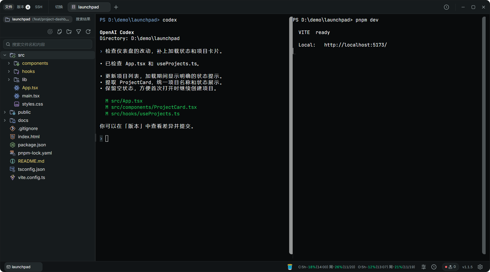
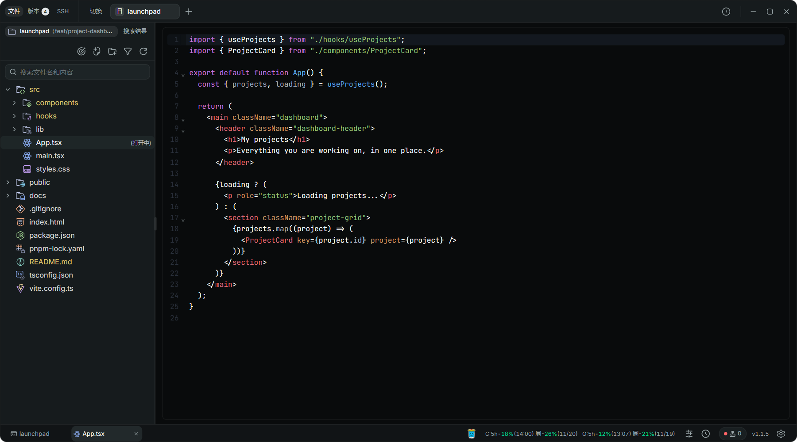
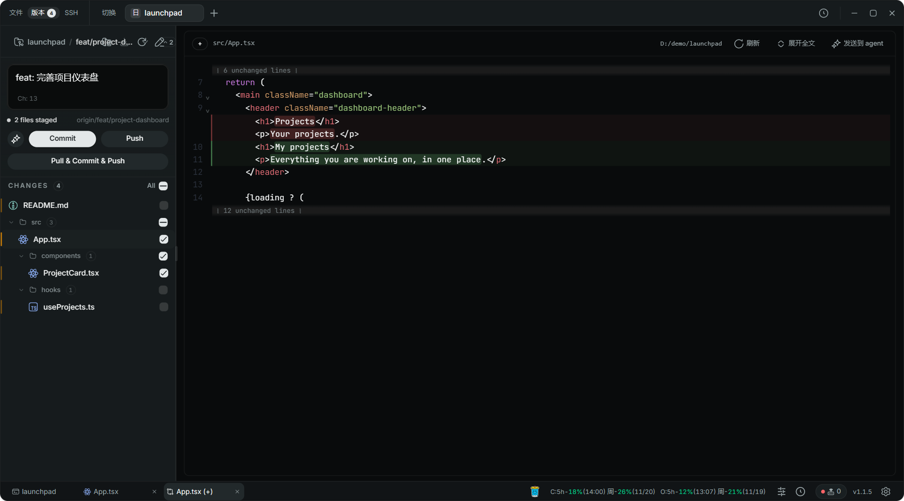
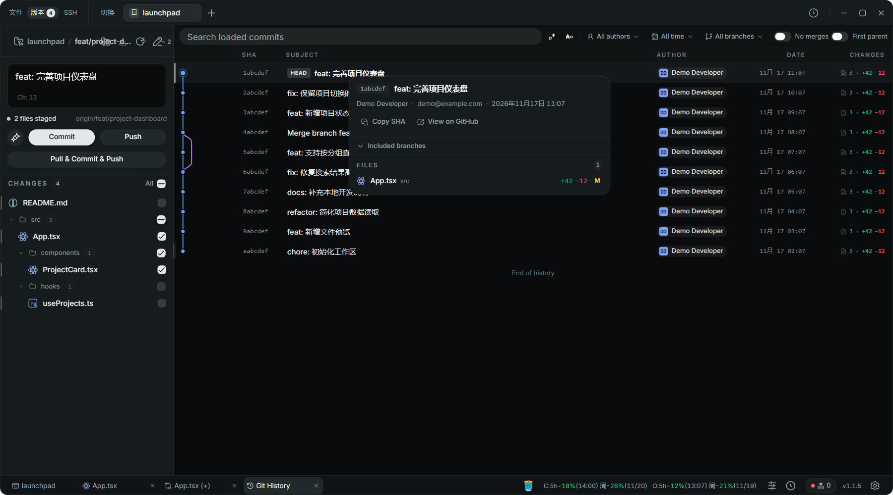
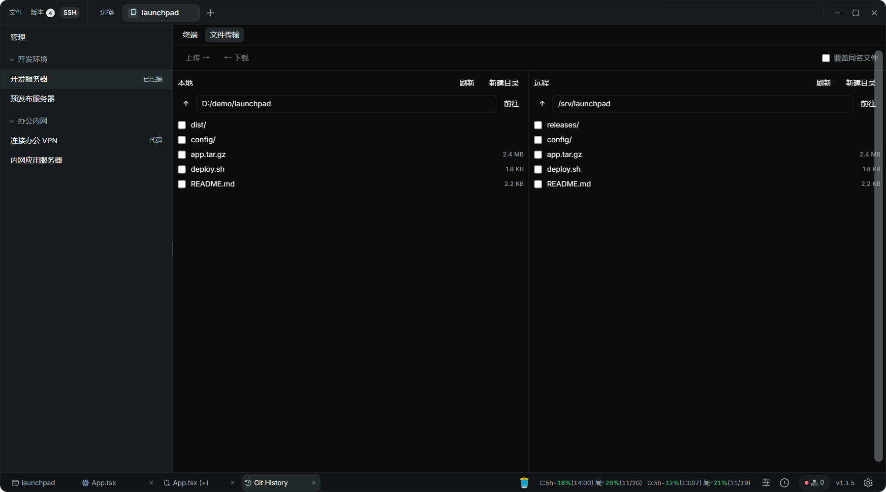

<div align="center">
  
  <h1>awei-work</h1>
  <p><a href="README.md">简体中文</a> · <strong>English</strong></p>
  <p><a href="https://github.com/zhiweiiii/awei-work/releases/latest">Download for Windows</a> · <a href="#features">Features</a> · <a href="docs/README.md">Documentation (Chinese)</a> · <a href="https://github.com/zhiweiiii/awei-work/issues">Report an issue</a></p>
</div>

If your daily work only needs Claude Code / Codex, Git, SSH, and a way to browse files, this app is for you.

Windows only.



> Screenshots show the current application UI with sample data. Projects, connections, terminal output, and usage figures are examples, not live model calls or server connections. The desktop UI is currently primarily in Chinese.

## Features

| Your daily work | What awei-work provides |
| --- | --- |
| Claude Code / Codex | Native terminals, split panes, project groups, session history and resume, usage display, and sending selected file content to an agent. |
| Git | Diffs, staging, commits, pushes, branch and repository management, and Commit Graph. Generate concise commit messages with background Codex and keep drafts per project and repository. |
| SSH | Grouped connections, remote terminals, and dual pane SFTP. Use dynamic scripts and group prerequisites, such as starting a VPN before connecting. |
| Files | File tree, filename and content search, code editing, Markdown and media previews, optional LSP, and Java project indexing. |
| Continue on your phone | View conversations, code, and tool results, send messages, and respond to supported interactive prompts in the same desktop session. |
| Development tools | One time or daily scheduled tasks, local web previews, a Claude Code provider gateway, themes, backgrounds, and keyboard shortcuts. |

## A look inside

### Code and files

Find code in the file tree, then inspect and edit it in the editor. Organize projects into groups and drag the top project tabs to reorder them. Reopened projects are appended at the end.



On restart, the app restores up to ten eligible projects based on when you last sent a message to an AI agent, along with Claude Code / Codex sessions whose identities have been confirmed.

### Review changes, then commit

Review the diff, stage files, generate a commit message, and commit. Each project and repository keeps its own draft. If you switch projects during generation, the result returns to the original repository.



Open the relevant Commit Graph from the branch and repository menu to inspect history and changed files. The commit context menu also lets you copy the corresponding remote branch's web URL.



### Servers and file transfers

SSH connections have dedicated remote terminals and dual pane file transfers. Passwords and key passphrases are stored in Windows Credential Manager. First connections and changed host fingerprints require confirmation.



For a group that requires a VPN, configure a dynamic script to run before connecting. The server connection starts after the prerequisite succeeds. Scripts run in separate Node.js processes and can be edited by an agent. See the [dynamic script guide (Chinese)](docs/connection-code.md).

### Continue the same session on your phone

Keep the desktop app running and use a reachable browser page on your phone to view and control the same terminal session. Set a personal password and connect over a trusted local network or VPN.


## Getting started

1. Download the Windows x64 `.exe` installer from [Releases](https://github.com/zhiweiiii/awei-work/releases/latest).
2. Install and sign in to Claude Code or Codex CLI, then open a project folder.
3. Run `claude` or `codex` in the terminal, or start or resume a conversation from the session menu.
4. Use “文件” (Files), “版本” (Git), and “SSH” at the top to switch tools. Use the bottom window bar to switch between terminals, files, and diffs.
5. For phone access, set a personal password in Settings and open the address shown by the app.

Installation requires administrator privileges; normal use usually does not. Before upgrading, save your files and exit the old app, then install the new release over the existing version.

## Practical limits

- **Phone access:** The PC and desktop app must stay running, and your phone must be able to reach the PC. The web bridge defaults to port `34268` in releases and `34269` in development. Do not expose it directly to the public internet. CLI UI changes may affect recognition of interactive prompts.
- **Scheduled tasks:** Send terminal input or run background Codex / Claude Code requests. Tasks cannot run while the app is closed or the PC is asleep. Background model requests may incur charges.
- **Connection automation:** Dynamic scripts require Node.js 22+ and run with your user privileges. Only run trusted scripts. Maintain your scripts and private connection settings locally; this repository does not ship private VPN examples.
- **Provider gateway:** Configure compatible endpoints, models, and context windows for Claude Code through a local loopback gateway. Model availability and access depend on the provider; changing a setting does not make an unavailable model accessible.

Further reading, in Chinese: [Mobile access](docs/mobile.md) · [Sessions, usage, and scheduled tasks](docs/agents.md) · [Known limitations](docs/issues.md).

## Run from source

Install Node.js 22+, pnpm, Rust stable, and the [Windows prerequisites for Tauri](https://tauri.app/start/prerequisites/).

```powershell
pnpm install --frozen-lockfile
pnpm tauri dev

# Build the Windows installer; changed sources automatically increment the patch version
pnpm tauri build
```

Quality checks:

```powershell
pnpm lint
pnpm check-types
cd src-tauri
cargo fmt --all -- --check
cargo clippy --all-targets --locked -- -D warnings
```

Built with Tauri 2 / Rust / React 19 / TypeScript / xterm.js / CodeMirror 6. See the [documentation index (Chinese)](docs/README.md) for architecture and maintenance notes.

## Origin and license

Based on [crynta/terax-ai](https://github.com/crynta/terax-ai), under the [Apache License 2.0](LICENSE). Original copyright notices are retained, and the app icon is derived from the upstream project.

awei-work focuses on everyday Claude Code / Codex development on Windows, adding SSH and file transfers, a mobile conversation view, session and usage tools, scheduled tasks, and a provider gateway.
