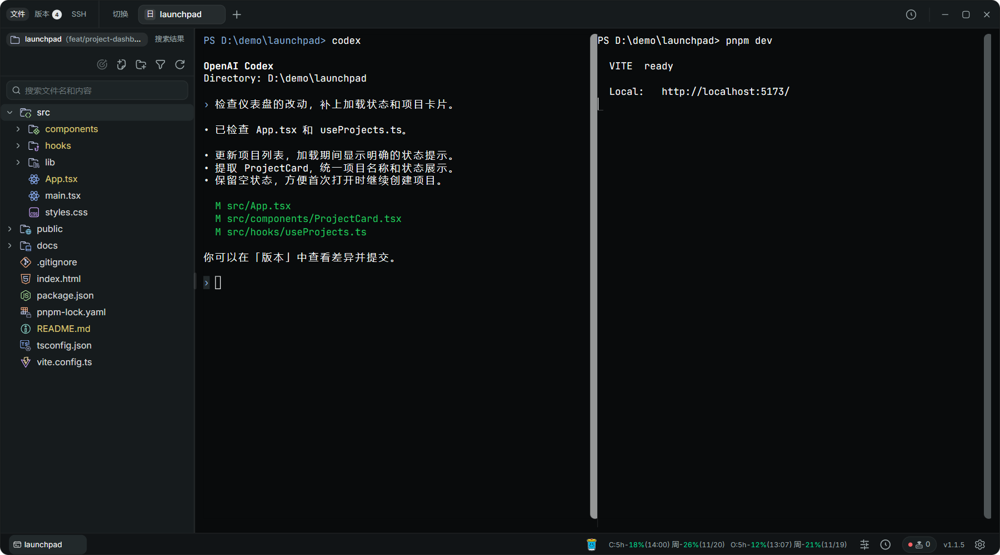
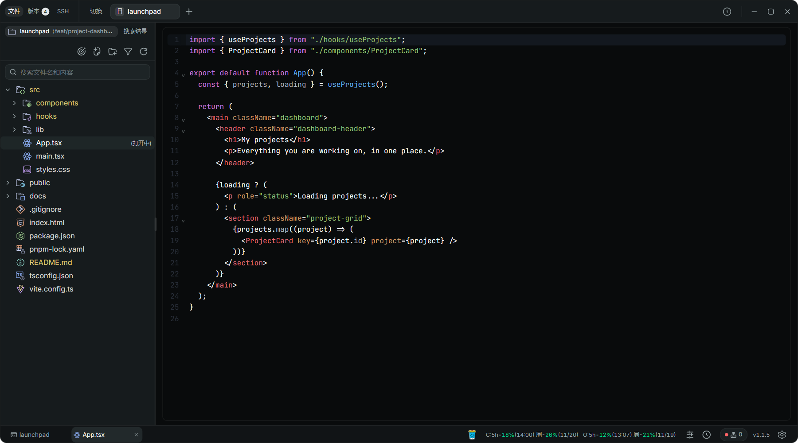
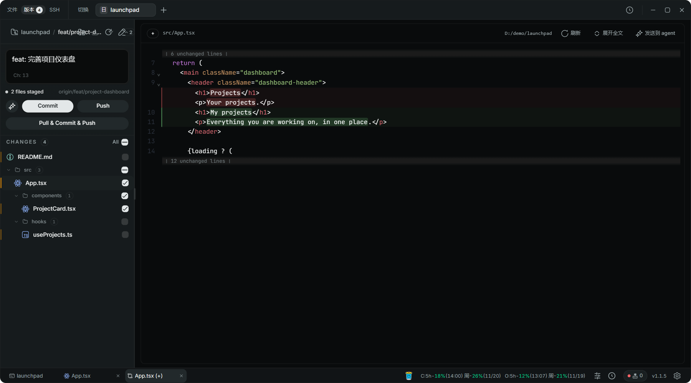
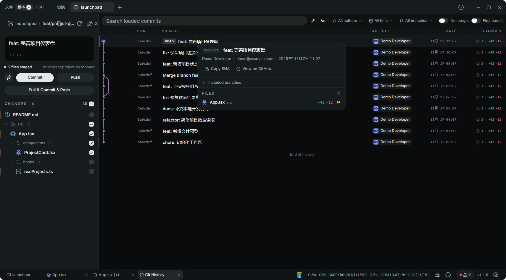
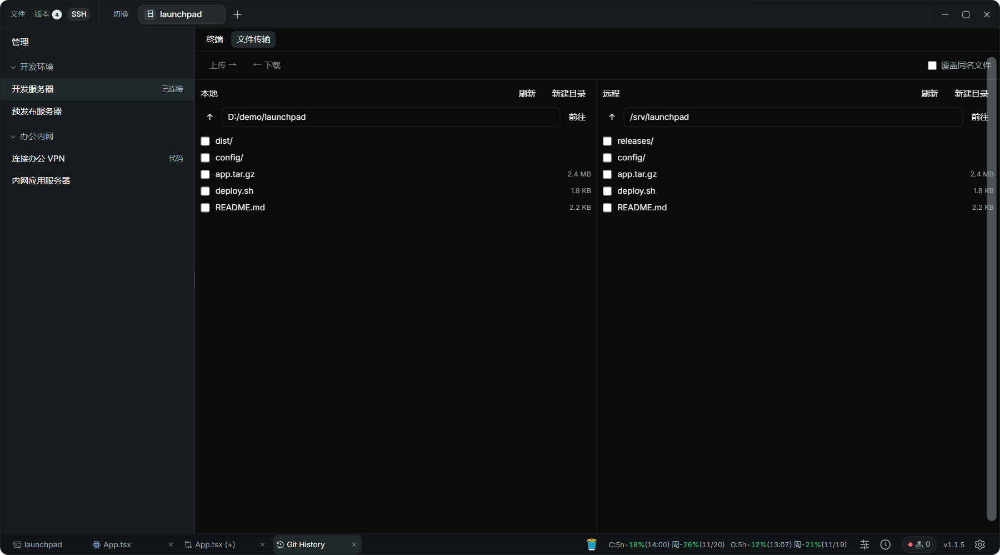

如果你日常工作只需要用claude code/codex，git，ssh，以及看看文件，那么这个软件就是为你准备的

<div align="center">
  
  <h1>awei-work</h1>
  <p>把 AI 终端、Git、SSH 和项目文件放进一个 Windows 工作区。</p>
  <p><strong>简体中文</strong> · <a href="README.en.md">English</a></p>
  <p><a href="https://github.com/zhiweiiii/awei-work/releases/latest">下载 Windows 版</a> · <a href="#功能一览">功能一览</a> · <a href="docs/README.md">使用与开发文档</a> · <a href="https://github.com/zhiweiiii/awei-work/issues">反馈问题</a></p>
</div>

你可以继续用熟悉的 Claude Code / Codex CLI 写代码，在同一个窗口里查看文件、检查差异、提交代码和连接服务器。离开电脑后，也能从手机继续查看和操作桌面的同一会话。

**仅支持 Windows。** Claude Code / Codex 需自行安装并登录，账号权限与模型费用由对应服务提供。



> 截图使用当前应用界面和演示数据，展示布局与操作入口；项目、连接、终端内容和用量均为示例，不代表真实模型调用或服务器连接。桌面界面目前以中文为主。

## 功能一览

| 日常工作 | 在 awei-work 中完成 |
| --- | --- |
| Claude Code / Codex | 原生终端、分屏、项目分组、会话历史与恢复、用量查看，支持把文件选区发送给 agent。 |
| Git | 查看差异、暂存与提交、推送、分支与仓库管理、Commit Graph；通过后台 Codex 生成简短提交信息，草稿按项目与仓库保留。 |
| SSH | 分组管理连接、远程终端、双栏 SFTP 文件传输；支持动态代码和分组连接前置任务，例如先启动 VPN。 |
| 文件 | 文件树、文件名与内容搜索、代码编辑、Markdown 与媒体预览，可选 LSP 与 Java 项目索引。 |
| 手机接着用 | 浏览器查看对话、代码和工具结果，发送消息、处理可识别的交互选项，共享桌面会话。 |
| 开发配套 | 单次或每日定时任务、本地网页预览、Claude Code 供应商网关、主题、背景与快捷键。 |

## 看看实际界面

### 写代码与查看文件

在文件树中定位代码，在编辑器里检查和修改文件。项目可以按分组收纳，顶部项目栏支持鼠标拖动排序；重新打开的项目追加到末尾。



重开应用时，根据最后向 AI 发消息的时间恢复最近 5 个符合条件的项目，以及已确认身份的 Claude Code / Codex 会话。

### 检查改动，再提交

先看差异，再暂存、生成提交信息和 Commit。每个项目、仓库有自己的提交草稿；生成期间切换项目，结果仍回填到原来的仓库。



从分支与仓库菜单打开对应的 Commit Graph，查看提交关系和文件改动。提交右键菜单也可复制对应远程分支的网页地址。



### 连接服务器与传文件

SSH 连接拥有独立的远程终端和双栏文件传输。密码和密钥口令保存在 Windows 凭据管理器，首次连接及主机指纹变化时需要确认。



需要先连 VPN 的分组，可以设置“连接前执行”的动态代码；执行成功后再连接分组中的服务器。脚本使用独立 Node.js 进程，可以交给 agent 修改，配置方式见[动态执行代码文档](docs/connection-code.md)。

### 手机继续同一会话

电脑保持运行，手机通过网络可达的浏览器页面查看和操作同一条终端会话。设置个人密码后，在可信局域网或 VPN 内使用。


## 开始使用

1. 从 [Releases](https://github.com/zhiweiiii/awei-work/releases/latest) 下载 Windows x64 的 `.exe` 安装包。
2. 安装并登录你使用的 Claude Code 或 Codex CLI，打开一个项目目录。
3. 在终端运行 `claude` 或 `codex`，也可以从会话菜单新建或恢复对话。
4. 用顶部的“文件”“版本”“SSH”切换工作内容，在底部窗口栏切换终端、文件和差异。
5. 需要手机访问时，在设置中配置个人密码，按应用显示的地址连接。

安装需要管理员权限，日常运行通常不需要。升级前保存文件并退出旧应用，下载新版安装包覆盖更新即可。

## 使用边界

- **手机访问**：电脑与应用需要保持运行，手机和电脑需要网络可达。Web 桥接正式端口默认为 `34268`，开发端口为 `34269`，请勿直接暴露到公网。手机交互选项的识别可能受 CLI 界面变化影响。
- **定时任务**：支持终端发送、后台 Codex 和后台 Claude Code；应用关闭或电脑休眠时不能执行，后台模型请求可能产生费用。
- **连接自动化**：动态代码需要 Node.js 22+，具有当前用户权限。仅运行你信任的脚本；脚本和私有连接配置需自行维护，仓库不附带私人 VPN 示例。
- **供应商网关**：可给 Claude Code 配置兼容接口、模型及上下文窗口，通过本地回环网关转发。可用模型与权限取决于供应商，修改设置不代表供应商一定提供该模型。

更多说明：[手机访问](docs/mobile.md) · [会话、用量与定时任务](docs/agents.md) · [已知限制](docs/issues.md)。

## 从源码运行

准备 Node.js 22+、pnpm、Rust stable，以及 [Windows Tauri 构建依赖](https://tauri.app/start/prerequisites/)。

```powershell
pnpm install --frozen-lockfile
pnpm tauri dev

# 构建 Windows 安装包，源码变化时自动递增 patch 版本
pnpm tauri build
```

质量检查：

```powershell
pnpm lint
pnpm check-types
cd src-tauri
cargo fmt --all -- --check
cargo clippy --all-targets --locked -- -D warnings
```

技术栈：Tauri 2 / Rust / React 19 / TypeScript / xterm.js / CodeMirror 6。架构和维护说明见[文档索引](docs/README.md)。

## 项目来源与许可

本项目基于 [crynta/terax-ai](https://github.com/crynta/terax-ai)，沿用 [Apache License 2.0](LICENSE)，保留原始版权声明，图标沿用上游基础。

awei-work 聚焦 Windows 下的 Claude Code / Codex 日常开发，补充 SSH 与文件传输、手机对话视图、会话与用量、定时任务、供应商网关等能力。
